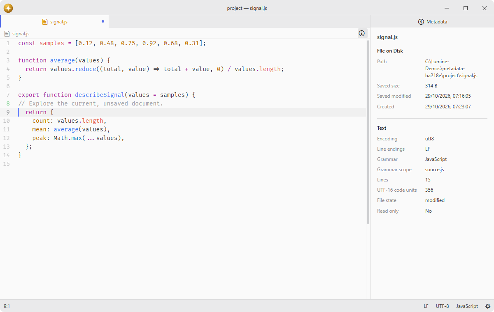

# metadata

Inspect metadata of the current document.

## Features

- **Document properties**: inspect text, notebook, image and PDF properties supplied by their pane items.
- **Saved file details**: distinguish the saved file's path, size and timestamps from the current document's state.
- **Movable inspector**: keep metadata in a normal workspace tab, initially in the right dock.
- **Breadcrumb action**: open the inspector for a specific document using its information icon.
- **Live updates**: refresh visible metadata when the document changes and cancel obsolete requests.



## Installation

This package is bundled with Lumine. To install another revision, search for `metadata` in the Install pane of the Lumine settings, or run `lumine --install lumine-code/metadata`.

## Commands

Commands available in `lumine-workspace`:

- `metadata:show`: show properties of the current document,
- `metadata:toggle`: show or hide the inspector,
- `metadata:toggle-focus`: focus the inspector or return focus to its document.

## Usage

The inspector follows the active document in the workspace center, including documents in additional windows. Focusing the inspector preserves the document being inspected. Move its tab into another dock or the center using the normal pane commands. Closing it releases its subscriptions; reopening creates a fresh inspector.

The File on Disk section describes the saved file. Other sections describe the current document and may include changes that have not yet been saved. A document without a path still exposes its own properties. Items can implement the core `getMetadata()` and `onDidChangeMetadata()` pane item protocol without registering a service.

## Customization

Add this to your stylesheet to adjust the inspector's spacing:

```css
.metadata {
  padding: 20px;
  font-size: 13px;
}

.metadata .metadata-section dl {
  gap: 10px 20px;
}
```

## Services

- [`metadata`](docs/metadata.md): provided to packages that open the inspector for a specific pane item.
- `breadcrumbs.actions`: consumed to contribute the information action to document breadcrumbs.
- `background-tips.provider`: provided to show a tip about inspecting document properties.

## Contributing

Got ideas to make this package better, found a bug, or want to help add new features? Just drop your thoughts on GitHub. Any feedback is welcome!
